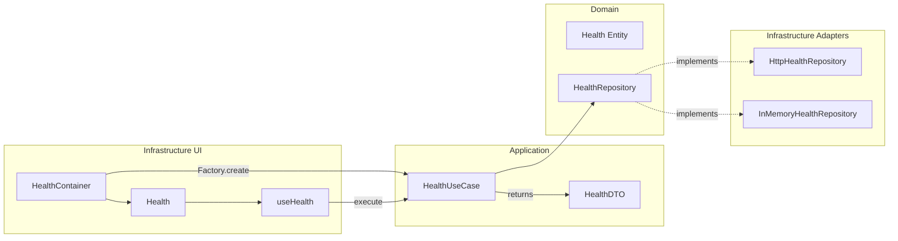

# Frontend Template con Arquitectura Hexagonal

## Resumen

Migrar la estructura actual a una aplicación React con Vite, implementando el módulo `health` como ejemplo de la arquitectura hexagonal, siguiendo todas las reglas definidas en `.cursor/rules/`.

## Estructura de Directorios

```
src/
├── shared/
│   ├── domain/
│   │   ├── DomainError.ts
│   │   ├── Maybe.ts
│   │   └── value-objects/
│   │       └── Id.ts
│   └── infrastructure/
│       ├── http/
│       │   └── HttpClient.ts         # Interface + FetchHttpClient
│       ├── factory.ts                # Wiring de dependencias
│       └── ui/
│           └── globals.css           # Variables CSS + reset
├── health/
│   ├── domain/
│   │   ├── entities/
│   │   │   └── Health.ts
│   │   └── repositories/
│   │       └── HealthRepository.ts   # Interface + InMemory
│   ├── application/
│   │   ├── HealthUseCase.ts
│   │   └── HealthDTO.ts
│   ├── infrastructure/
│   │   ├── adapters/
│   │   │   └── HttpHealthRepository.ts
│   │   └── ui/
│   │       ├── Health.tsx
│   │       ├── Health.hook.ts
│   │       └── Health.module.css
│   └── tests/
│       ├── unit/
│       │   ├── domain/
│       │   │   └── Health.test.ts
│       │   ├── application/
│       │   │   └── HealthUseCase.test.ts
│       │   └── infrastructure/
│       │       └── ui/
│       │           ├── Health.hook.test.ts
│       │           └── Health.test.tsx
│       ├── integration/
│       │   └── HttpHealthRepository.integration.test.ts
│       └── e2e/
│           └── Health.spec.ts
├── App.tsx                           # Router principal
├── main.tsx                          # Entry point
└── index.css                         # Import globals
```

## Dependencias Principales

- **React 19** + **React Router 7**
- **Vite 6** como bundler
- **@testing-library/react** para tests de hooks y componentes
- **Playwright** para E2E (configuración base)

## Implementaciones Clave

### 1. HttpClient Switcheable

```typescript
// Configuración via variable de entorno
const apiBaseUrl = import.meta.env.VITE_API_URL || '/api';
```

- `VITE_API_URL=http://localhost:3000/api` - Backend real
- Sin variable o `/api` - Desarrollo local/mock

### 2. Factory con Soporte Mock

El [factory.ts](src/shared/infrastructure/factory.ts) permitirá:

- Modo **producción**: HttpHealthRepository conectado al backend
- Modo **desarrollo**: InMemoryHealthRepository con datos de prueba

### 3. Patrón Container (según reglas)

Siguiendo [frontend-components.mdc](.cursor/rules/frontend-components.mdc):

- `Health` - Componente presentacional (testeable con InMemory)
- `HealthContainer` - Usa Factory (para routing)

### 4. Hook Pattern (según reglas)

Siguiendo [frontend-hooks.mdc](.cursor/rules/frontend-hooks.mdc):

- Un solo `useState` con estado agrupado
- Sin `useEffect` dentro del hook
- UseCase recibido como parámetro
- Retorno sin destructuring

## Flujo de Datos



## Archivos a Modificar/Crear

| Archivo | Accion |

|---------|--------|

| [package.json](package.json) | Actualizar con deps de React/Vite |

| [tsconfig.json](tsconfig.json) | Ajustar para Vite + React |

| [vite.config.ts](vite.config.ts) | Nuevo - config Vite |

| [jest.config.js](jest.config.js) | Actualizar para React Testing Library |

| `src/shared/**` | Nuevo - DomainError, Maybe, Id, HttpClient, Factory |

| `src/health/**` | Nuevo - Modulo completo con tests |

| `src/App.tsx` | Nuevo - Router principal |

| `src/main.tsx` | Nuevo - Entry point |

| `playwright.config.ts` | Nuevo - Config base E2E |

| `index.html` | Nuevo - HTML entry para Vite |

## Fases de Implementacion

### Fase 1: Configuracion Base

Configurar Vite, actualizar dependencias, crear estructura de carpetas.

### Fase 2: Shared Domain

Implementar Maybe, DomainError, Id (copiar del backend adaptando).

### Fase 3: Shared Infrastructure

Crear HttpClient, Factory base, globals.css con theming.

### Fase 4: Health Module (Inside-Out)

Siguiendo TDD y el orden inside-out:

1. Health entity + unit tests (`tests/unit/domain/`)
2. InMemoryHealthRepository
3. HealthUseCase + unit tests (`tests/unit/application/`)
4. useHealth hook + unit tests (`tests/unit/infrastructure/ui/`)
5. Health component + unit tests (`tests/unit/infrastructure/ui/`)
6. HttpHealthRepository + integration tests (`tests/integration/`)

### Fase 5: Wiring Final

App.tsx con routing, main.tsx, verificar que todo funciona.

### Fase 6: E2E Tests

Tests end-to-end con Playwright (`tests/e2e/Health.spec.ts`) para el flujo completo de Health:

- Verificar que la pagina de health carga correctamente
- Mostrar el estado del sistema
- Manejo de errores de conexion